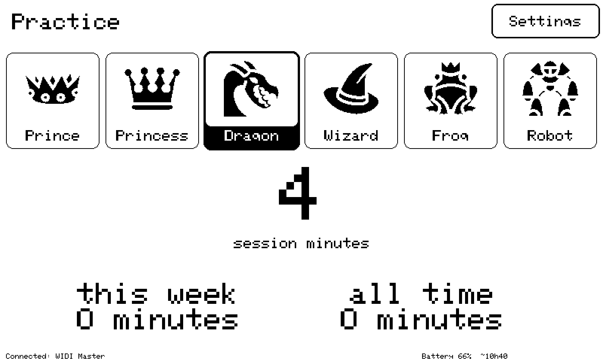
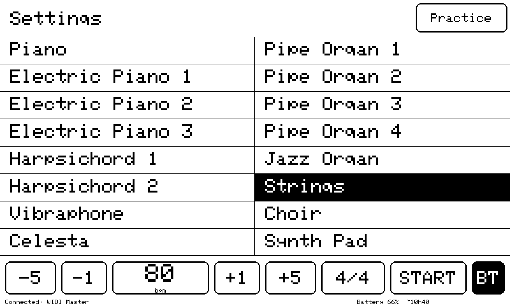

# Sticky Piano Remote

An e-ink touch remote for a **Yamaha YUS3 SH-TA** (SILENT Piano™ / TransAcoustic™
control unit). It runs on a **Seeed reTerminal Sticky** and talks Bluetooth LE MIDI
to a **CME WIDI Master** plugged into the piano's MIDI IN/OUT — with per-persona
practice tracking built in.

```
[reTerminal Sticky] ──BLE-MIDI──> [WIDI Master] ──5-pin DIN──> [SH-TA control unit]
     (central)                      (peripheral)      <──────── MIDI OUT
```

## Features

- **Voices:** the 16 panel voices in a 2×8 grid; tap one to select it. The piano
  switches straight away and the screen catches up (~0.5 s e-ink refresh).
- **Follows the piano:** voices picked on the piano's own panel show up on the
  Sticky, including the dual voices 17–19 ("Piano + Strings", …).
- **Practice tracking:** six personas (Prince, Princess, Dragon, Wizard, Frog,
  Robot); tap yours and the device records played **minutes** — the live session
  count, plus per-persona *this week* (Mon–Sun) and *all time* totals, kept in
  flash across power off/on.
  - Only actual playing counts: the session accumulates played time, pauses
    (frozen, not reset) during breaks up to 5 minutes, and closes after a longer
    break.
  - Everything is plain minutes — "I've done 1000 minutes".
- **Metronome:** plays the piano's own metronome click/bell sounds over MIDI.
  - Tempo from 5 to 500 bpm, with −5/−1/+1/+5 buttons, or tap the bpm number for a keypad.
  - Beats per bar: click only (default), 4, 3, 2 or 6, with a bell on beat 1.
  - Tempo and beats-per-bar are remembered across power off/on; it always
    starts stopped.
- **Bluetooth screen** (BT button): Bluetooth on/off, scan, tap a device to
  connect (it's remembered), disconnect. It reconnects automatically.
- **Power:** hold the power button 1.5 s to turn off: the screen shows "Off"
  and the Sticky goes into deep sleep. Press the power button to turn it back on.
- **Battery while off:** the off screen shows a battery bar with the charge %
  and refreshes as it changes. Plugging the charger in while off is noticed
  too, within about an hour.
- **Auto-off:** after **10 minutes without use** it turns itself off.
  - Taps, button presses and anything played on the piano (keys, pedals, panel
    voice changes) count as use.
  - A running metronome or an open Bluetooth connection doesn't, so a forgotten
    Sticky won't drain its battery.
  - After waking, the status line shows how long it was off and how much battery that used.
- **Battery:** the status line shows the charge % and estimated time left.

## Screens




Rendered previews of both screens (sample values; on the device the fonts are
the panel's chunky bitmap font).

Battery life is about **12 hours** of use (measured 60 mA connected and idle).
Turned off, it draws ~0.5 mA (the e-ink holds its image; the hourly battery
check is included) — weeks of standby. Wake report shows the measured drain.
Charge it over USB-C.

## Using it

- **Practice tracking:** on the Practice screen, tap your persona; the big
  counter starts at zero and climbs as you play. Stop playing and it freezes;
  a break up to 5 minutes resumes where you left off, a longer break closes
  the session (its minutes are already banked in "this week" and "all time").
- **First-time setup:** the practice timer needs a valid wall clock. Set it
  once over USB with the serial console (commands below); the RTC keeps time
  as long as the device has power — only a deep battery drain asks again.
- **Keep the piano in a mode where its digital voices play** (TransAcoustic™ or
  Silent). MIDI notes and voices drive the piano's tone generator.
- The piano's own display doesn't change when the voice comes from the Sticky,
  but the sound does.
- Only one device can be connected to the WIDI at a time. If the Sticky stays on
  "Not connected", check that a laptop or phone isn't holding the WIDI.
  See [Troubleshooting](#troubleshooting).

## Building and flashing

Requires [PlatformIO](https://platformio.org/). The first build downloads the
pioarduino ESP32 platform, which takes a few minutes.

```sh
pio run -e sticky                 # build
pio run -e sticky -t upload       # flash (Sticky on USB, appears as /dev/ttyACM0)
pio device monitor -b 115200      # serial log
```

The Sticky enumerates through its CH343 USB-UART. Opening the serial port resets
the board, and the monitor must not be open during an upload.

Build-time options (`build_flags` in `platformio.ini`):

| Flag | Default | Meaning |
|---|---|---|
| `-DMIDI_CHANNEL=n` | 1 | Channel the piano's voice part listens on |

The auto-off delay is `cfg::kIdleOffMs` in `src/config.h`.

Per-setup options go in `src/config_local.h` (git-ignored): copy
`src/config_local.h.example`. You can set your WIDI's address there. Without it,
the Sticky connects to the first BLE-MIDI device it finds and remembers it.
Pins and the voice table are in `src/config.h`.

### Serial console

Besides the log, the serial port takes line commands (useful for setup and
diagnostics; the practice timer only records while the clock is valid):

| Command | Effect |
|---|---|
| `clockset YYYY-MM-DD HH:MM:SS` | Set the PCF8563 wall clock (needed once — see Using it) |
| `dumppractice` | Week/all-time minutes per persona |
| `dumpclock` / `dumpble` / `dumpstate` | Clock, BLE link and practice internals |
| `wipepractice` | Reset all practice counters |

## Project layout

```
src/
  main.cpp        setup/loop wiring
  config.h        pins, MIDI constants, voice table
  config_local.h.example   per-setup options (WIDI address, channel)
  ui.*            e-ink screens: Practice home (personas, timer), voice grid,
                  metronome bar, tempo keypad, Bluetooth
  practice.*      persona selection, play detection, session/week/all-time buckets
  rtc.*           PCF8563 wall clock (validity-gated, settable)
  persona_art.h   generated persona bitmaps (do not edit — see tools/gen_icons.py)
  ble_midi.*      BLE connection manager, BLE-MIDI framing, receive parser, voice sync
  metronome.*     metronome timing task
  touch.*         GT911 touch driver + tap queue
  battery.*       BQ27220 fuel gauge readout
  power.*         power latch, power button, deep sleep
lib/              display/board support from papyrix-reader (MIT, see lib/README.md)
tools/
  widi_voice.py   laptop BLE-MIDI test tool (scan, monitor, voices, metronome)
  gen_icons.py    regenerates src/persona_art.h from game-icons.net SVGs
docs/
  PROTOCOL.md     WIDI + piano MIDI facts (verified)
  HARDWARE.md     reTerminal Sticky notes, driver changes, power measurements
  PLAN.md         practice-timer design (rules, storage, deferred ideas)
  mockups/        UI previews and icon renders
```

## Laptop test tool

To try MIDI ideas without reflashing, talk to the WIDI from a Linux laptop:

```sh
python3 -m venv tools/.venv && tools/.venv/bin/pip install -r tools/requirements.txt
tools/.venv/bin/python tools/widi_voice.py monitor            # see what the piano sends
tools/.venv/bin/python tools/widi_voice.py voice "Strings"    # set a voice + play a note
```

Turn the Sticky off first, because the WIDI accepts only one connection.

## Troubleshooting

- **"Not connected (retrying WIDI Master)" forever:**
  - Another central is holding the WIDI. On Linux, PipeWire connects to it
    automatically; run `bluetoothctl disconnect <WIDI address>`.
  - If that doesn't help, power-cycle the WIDI (unplug it from the piano for 5 s).
- **Taps register but the piano doesn't react:** the piano is in acoustic-only
  mode; switch to TransAcoustic™ or Silent.
- **Wrong voice names:** the table in `src/config.h` comes from the SH-TA owner's
  manual (bank MSB 108). Check it with `widi_voice.py monitor` while changing
  voices on the panel.

## License

MIT, see [LICENSE](LICENSE). The libraries in `lib/` are third-party (MIT);
see [lib/README.md](lib/README.md).

## Third-party components

| Component | License | Source |
|---|---|---|
| `lib/` display/board/SD/logging libs | MIT | [papyrix-reader](https://github.com/bigbag/papyrix-reader) (parts from FreeInk, MIT) |
| [Adafruit GFX Library](https://github.com/adafruit/Adafruit-GFX-Library) (incl. the classic 5x7 font) | BSD-3-Clause | PlatformIO dep (`platformio.ini`) |
| [NimBLE-Arduino](https://github.com/h2zero/NimBLE-Arduino) | Apache-2.0 | PlatformIO dep (`platformio.ini`) |
| Persona icons | CC BY 3.0 | [game-icons.net](https://game-icons.net), see Credits |

## Credits

- Display driver, board support and SD power control come from
  [papyrix-reader](https://github.com/bigbag/papyrix-reader), MIT licensed. Our
  changes are listed in `docs/HARDWARE.md`.
- Persona icons are from [game-icons.net](https://game-icons.net) under
  [CC BY 3.0](https://creativecommons.org/licenses/by/3.0/): "crown",
  "queen-crown", "dragon-head", "pointy-hat" and "robot-golem" by **Lorc**;
  "frog-prince" by **Delapouite**. Modified: cropped and downscaled to 80x80
  1-bit bitmaps.
